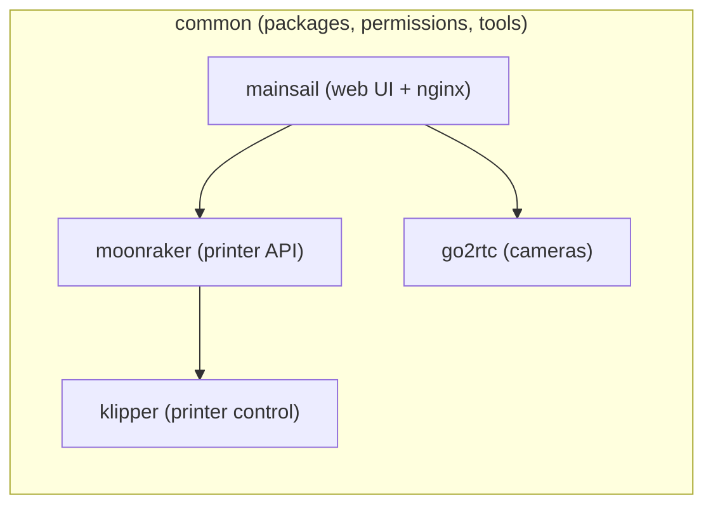

# FarmLAB

## Printers

Open <https://farmlab.lemaker.fr>

|             | Voron 0.2   | Artillery Sidewinder X1 | Wanhao Duplicator 12/300 |
| ----------- | ----------- | ----------------------- | ------------------------ |
| Reliability | Very good   | Bad                     | TODO                     |
| Speed       | Very fast   | Slow                    | TODO                     |
| Size (mm)   | 120x120x120 | 300x300x400             | 300x300x400              |

### Slicer configs

Import [farmlab_bundle.ini](docs/slicer_configs/superslicer/farmlab_bundle.ini)
in SuperSlicer via **File -> Import -> Import Config Bundle**.

Use SuperSlicer **2.7.61.6** and select the matching machine, nozzle and
**NORMAL <material>** print preset, then its filament preset. Stock printers
usually have a 0.4mm brass nozzle.

Those settings are from
[Ellis's profiles](https://github.com/AndrewEllis93/Ellis-SuperSlicer-Profiles)
and [tuning guide](https://ellis3dp.com/Print-Tuning-Guide/), with Kobra
settings checked against
[Anycubic's profiles](https://github.com/ANYCUBIC-3D/AnycubicSlicerNext/tree/main/resources/profiles/Anycubic).

Upload to the matching printer in Mainsail and watch the first layer.

### Materials

| Filament     | Voron 0.2 | Artillery Sidewinder X1 | Anycubic Kobra 3 ACE | Anycubic Kobra 3 - External Spool | Wanhao Duplicator 12/300 |
| ------------ | --------- | ----------------------- | -------------------- | --------------------------------- | ------------------------ |
| PLA          | ✓         | ✓                       | ✓                    | ✓                                 | ✓                        |
| PETG         | ✓         | ✓                       | ✓                    | ✓                                 | ✓                        |
| ABS          | ✓         | ×                       | ×                    | ×                                 | ×                        |
| ASA          | ✓         | ×                       | ×                    | ×                                 | ×                        |
| PC           | ✓         | ×                       | ×                    | ×                                 | ×                        |
| PA (CoPA)    | ✓         | ×                       | ×                    | ×                                 | ×                        |
| TPU 95A      | ×         | ✓                       | ×\*\*                | ✓                                 | ×                        |
| TPC-91A      | ×         | ×                       | ×\*\*                | ✓                                 | ×                        |
| PETG-CF/GF\* | ×         | ×                       | ×                    | ×                                 | ×                        |

- \* Abrasive filaments require hardened nozzles (ask before printing) and have
  no stock-hardware presets.
- \*\* ACE does not support flexible filaments!

______________________________________________________________________

## Deploying

### Roles Overview



### Printer configs

[inventory.yml](inventory.yml): names, USB paths, cameras and ports

[roles/klipper/templates](roles/klipper/templates):

| Printer                  | Shared model config               | Calibration                                 |
| ------------------------ | --------------------------------- | ------------------------------------------- |
| Artillery Sidewinder X1  | `artillery_sidewinder_x1.cfg.j2`  | `artillery_1.cfg.j2` / `artillery_2.cfg.j2` |
| Voron 0.2                | `voron_0_2_skr_pico.cfg.j2`       | `voron_lucas.ladreyt.cfg.j2`                |
| Wanhao Duplicator 12/300 | `wanhao_duplicator_12_300.cfg.j2` | `wanhao.cfg.j2`                             |

Macros: `macros.cfg.j2`, or `voron_0_2_macros.cfg.j2` for Voron.

**PLEASE! Keep calibration in the per-printer file, in this repo**

### SSH config

Make sure this block is present in your `~/.ssh/config`

```
Host farmlab
    HostName 10.69.16.19
    User pi
    IdentityFile "~/.ssh/farmlab_ssh_key"
```

Make sure you can ssh to the pi: `ssh farmlab`

### Deploy it!

Make sure Ansible and npm are installed on your computer.

```bash
ansible-playbook -i inventory.yml main.yml
```

For printer configs only:

```bash
ansible-playbook -i inventory.yml main.yml --tags klipper_cfg
```

### Calibrating a printer

> run commands in the printer's console on <https://farmlab.lemaker.fr>

[Ellis' tuning guide](https://ellis3dp.com/Print-Tuning-Guide/articles/index_tuning.html).

[PID calibration](https://www.klipper3d.org/Config_checks.html#calibrate-pid-settings):

Preheat the bed, home, then:

|               | Artillery Sidewinder X1 | Voron 0.2                           | Wanhao Duplicator 12/300            |
| ------------- | ----------------------- | ----------------------------------- | ----------------------------------- |
| Bed leveling  | `BED_SCREWS_ADJUST`     | `BED_SCREWS_ADJUST`                 | `BED_SCREWS_ADJUST`                 |
| Z calibration | `PROBE_CALIBRATE`       | `Z_ENDSTOP_CALIBRATE` at bed center | `Z_ENDSTOP_CALIBRATE` at bed center |
| Bed mesh      | Automatic\*             | No mesh                             | `BED_MESH_CALIBRATE METHOD=manual`  |

Use the wizard and a sheet of paper.

Copy the resulting PID values, `z_offset` (Artillery) or `position_endstop`
(Voron/Wanhao) into the per-printer template, and deploy with Ansible. Move any
`SAVE_CONFIG` overrides into git before deploying.

### Flashing firmware

> you can find pictures of the wirings in `docs/wirings`

#### Artillery Sidewinder X1 (MKS Gen L v1.0)

```bash
cd /home/pi/klipper
make menuconfig # AVR, ATmega2560, 16MHz; see artillery_sidewinder_x1.cfg.j2
make clean
make
```

Set `FLASH_DEVICE` to that printer's `mcus.main` path from inventory.yml. Hold
the reset button, and release it right after starting this command:

```bash
avrdude -cwiring -patmega2560 -P "$FLASH_DEVICE" -D -Uflash:w:out/klipper.elf.hex:i
```

To dump existing firmware instead:

```bash
avrdude -patmega2560 -cwiring -P "$FLASH_DEVICE" -Uflash:r:dump.hex:i
```

You can find the stock firmware in
[original.hex](docs/firmware/artillery_sidewinder_x1/original.hex).

#### Wanhao Duplicator 12/300 (MKS Robin Nano v1.2)

Dumping existing firmware? Not possible :)) (amazing STM32 Readout Protection)

```bash
cd /home/pi/klipper
make menuconfig # STM32F103, 8MHz crystal, 28KiB bootloader, serial USART3 PB11/PB10
make clean
make
./scripts/update_mks_robin.py out/klipper.bin out/Robin_nano35.bin
# Copy to sd card, insert it in the printer, and power it on to flash
```

#### Voron 0.2 (SKR Pico + Klipper Expander)

```bash
scp docs/firmware/voron_0_2/*.config farmlab:/home/pi/
ssh farmlab
cd /home/pi/klipper
```

For the SKR Pico, make sure the BOOT jumper is there and press RESET. Mount the
`RPI-RP2` drive if it does not appear automatically.

```bash
cp ~/SKR_PICO_V1.0.config .config
make olddefconfig
make clean
make
cp out/klipper.uf2 /media/pi/RPI-RP2/
sync
```

Remove BOOT and press RESET.

For the expander, fit its BOOT jumper and press RESET, then:

```bash
cp ~/STM32-Klipper-Expander.config .config
make olddefconfig
make clean
make
sudo dfu-util --list
sudo dfu-util -d 0483:df11 -a 0 -s 0x08000000:leave -D out/klipper.bin
```

Check that `dfu-util --list` shows the expander as `0483:df11` before flashing.
Remove BOOT and press RESET.

#### Anycubic Kobra 3 + ACE Pro (Rinkhals)

[Rinkhals](https://github.com/rinkhals-community/Rinkhals) adds
Moonraker/Mainsail while keeping Anycubic's printing software, touchscreen and
calibration routines. You can see it as an overlay or a plugin to the stock
Anycubic firmware.

Follow the
[USB installation guide](https://rinkhals-community.github.io/Rinkhals/guides/rinkhals-quick-start/)
using the interactive installer for Kobra 3. Check firmware compatibility first,
use **Tools -> Backup partitions**, and install only while the printer is idle.
Enable LAN-only mode and make sure the Pi can reach the printer on Wi-Fi.
